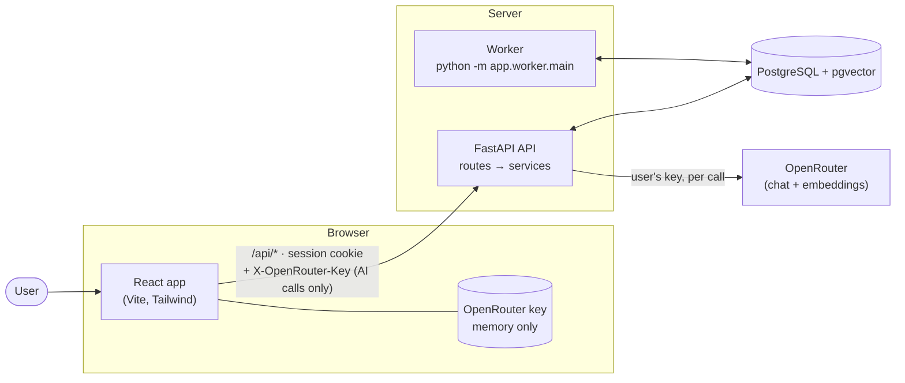
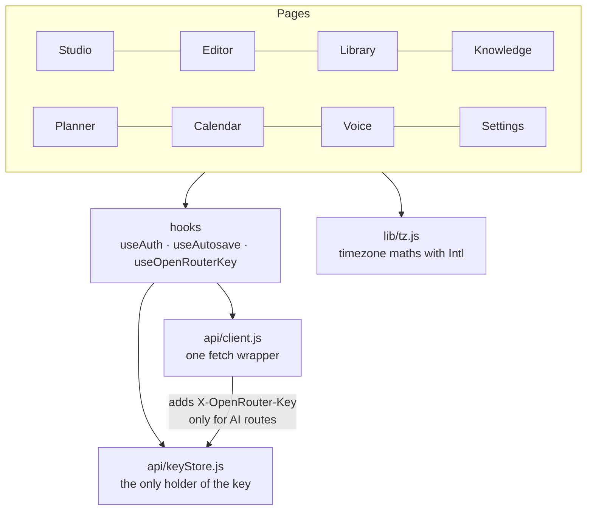
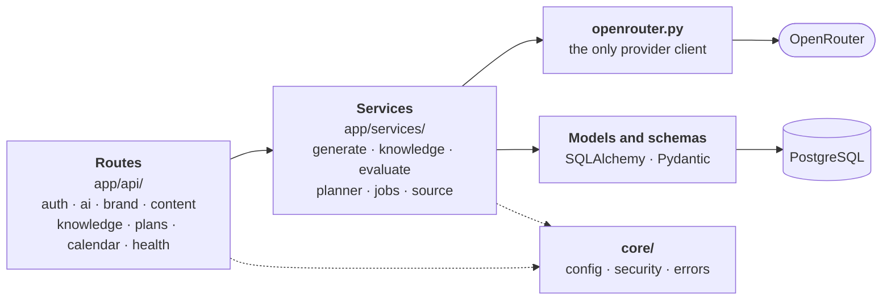
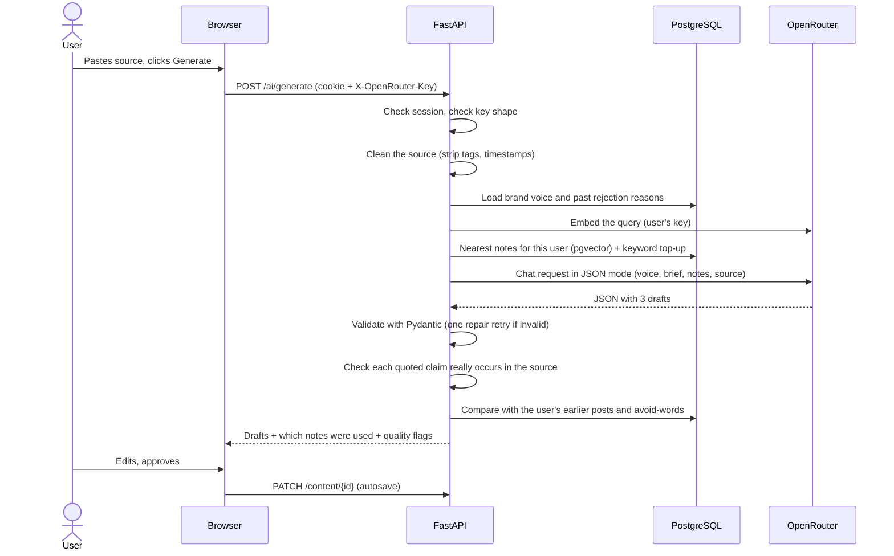
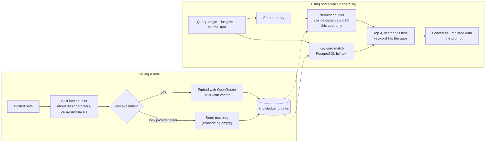
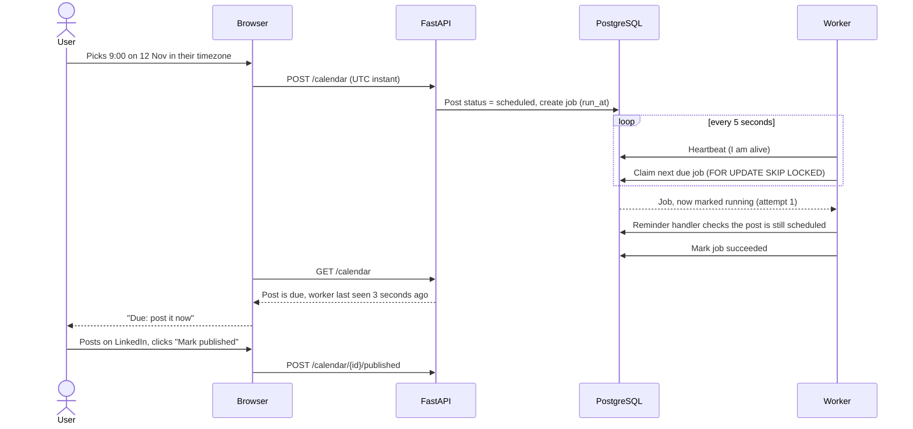
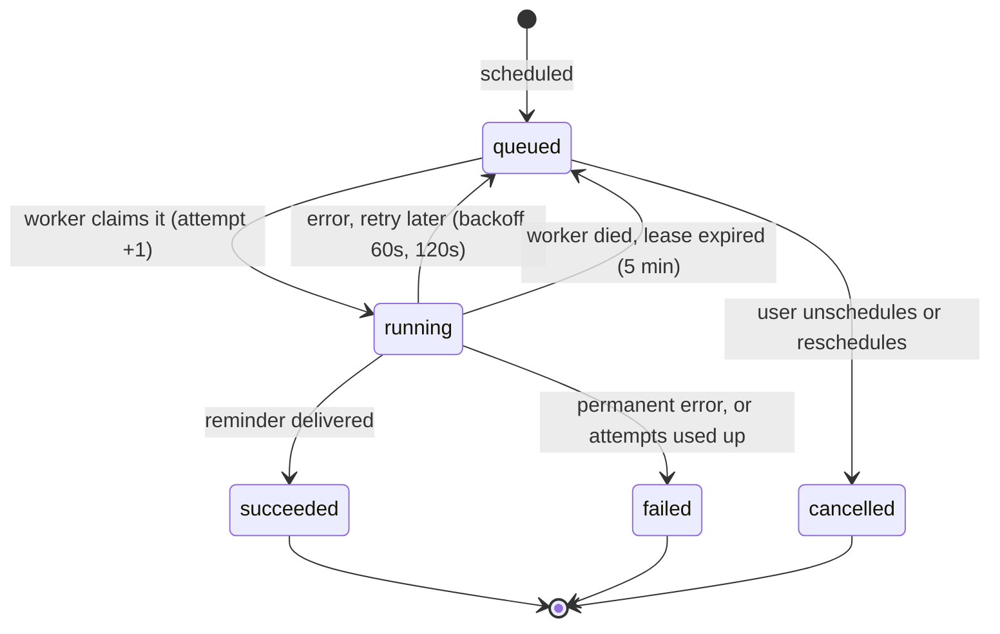
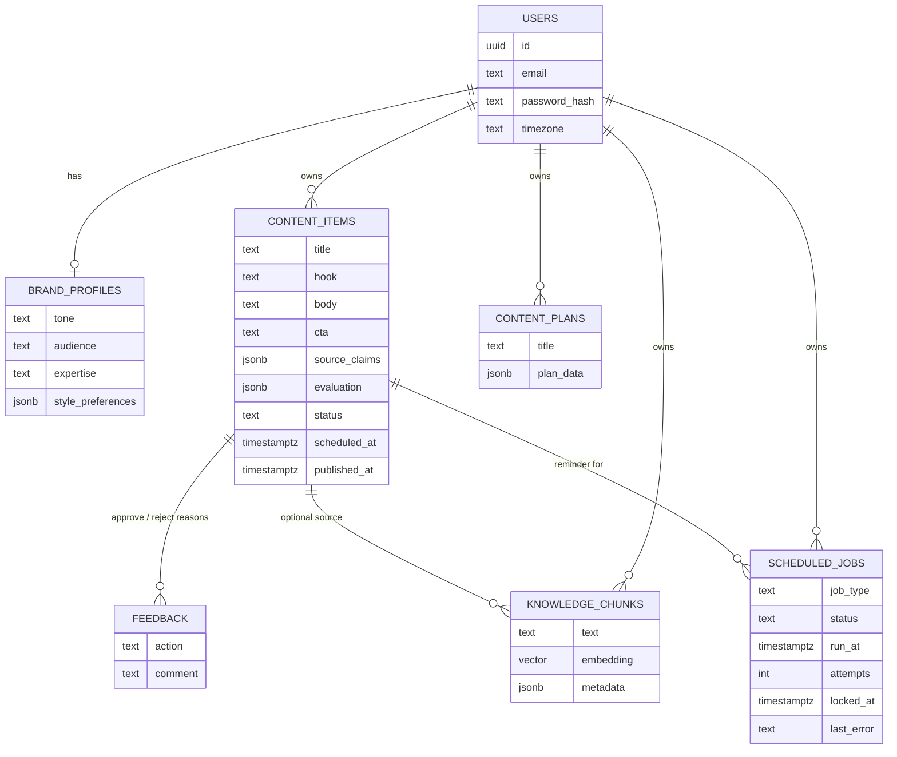
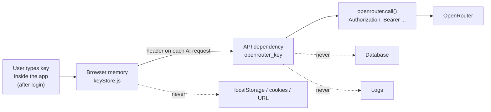

# Architecture: how LinkedIn Growth Copilot works

This document explains what the app does, what it is built from, and how the pieces behave at run time. It is written for someone who has just opened the repository. Read top to bottom for the full picture, or jump to a section.

1. [What the app does](#1-what-the-app-does)
2. [The system at a glance](#2-the-system-at-a-glance)
3. [The three kinds of work the system does](#3-the-three-kinds-of-work-the-system-does)
4. [Frontend](#4-frontend)
5. [Backend (API)](#5-backend-api)
6. [Flow A: from source text to drafts](#6-flow-a-from-source-text-to-drafts)
7. [Flow B: knowledge base and retrieval](#7-flow-b-knowledge-base-and-retrieval)
8. [Flow C: from schedule to reminder (the worker)](#8-flow-c-from-schedule-to-reminder-the-worker)
9. [Data model](#9-data-model)
10. [Security model: the OpenRouter key and sessions](#10-security-model-the-openrouter-key-and-sessions)
11. [Reliability: what happens when things fail](#11-reliability-what-happens-when-things-fail)
12. [Design decisions and trade-offs](#12-design-decisions-and-trade-offs)
13. [Repository map](#13-repository-map)
14. [Known limits](#14-known-limits)

The diagrams use [Mermaid](https://mermaid.js.org/), which GitHub draws automatically.

---

## 1. What the app does

A person who posts on LinkedIn pastes some raw material (an article, a transcript, rough notes, an idea). The app helps them turn it into posts that sound like them, checks the posts, plans a week, and reminds them when to publish.

| Feature | In one line |
|---|---|
| **Studio** | Clean a source, extract insights backed by real quotes, generate three structured drafts |
| **Editor and Library** | Edit with autosave, approve or reject (with a reason), filter by status |
| **Brand voice** | Tone, audience, words to avoid, example posts |
| **Knowledge base** | Personal notes that ground drafts in the author's own material |
| **Quality check** | Server-side repeat and avoid-word detection, plus an optional 1 to 5 model review |
| **Planner** | Propose a week of posts from a goal; convert any card to a draft |
| **Calendar** | Schedule in the user's timezone; a worker marks posts due as reminders |

Two product decisions shape the whole design:

- **Bring your own key.** Every user supplies their own OpenRouter key. The server has no AI key of its own.
- **Reminder, not auto-posting.** Scheduling never posts to LinkedIn. No LinkedIn credentials exist anywhere in the system.

---

## 2. The system at a glance



Five parts, three of which you run yourself:

- **Browser app** draws the screens and holds the OpenRouter key in memory.
- **API** (FastAPI) is the only thing the browser talks to. It checks who you are, applies the rules, and calls OpenRouter when an AI action is needed.
- **PostgreSQL with pgvector** stores everything: accounts, drafts, notes with their embeddings, plans, and the job queue.
- **Worker** is a second Python process that watches the database for scheduled posts that have come due.
- **OpenRouter** is an external service that provides the language and embedding models.

The API and the worker never talk to each other directly. They communicate through the database, which also acts as the queue. There is no Redis, message broker, or container orchestration to run.

---

## 3. The three kinds of work the system does

It helps to separate what happens **while a user waits** from what happens **later**:

| Kind | Examples | Runs in | Needs the user's key? |
|---|---|---|---|
| Ordinary requests | log in, list drafts, save an edit, view the calendar | API | No |
| AI requests (synchronous) | summarize, generate, evaluate, plan, embed notes | API, calling OpenRouter | **Yes**, sent with that request |
| Background work | turn a scheduled post into a "due" reminder | Worker | **No**, jobs hold no credentials |

This split is why the worker needs no secrets: the only job it runs is a reminder, and a reminder needs nothing from OpenRouter.

---

## 4. Frontend

**Stack:** React 19, JavaScript (no TypeScript), Vite, Tailwind CSS, react-router. UI components are hand-written in the shadcn style.



Things worth knowing:

- **Routing.** `/login` and `/register` are public. Everything under `/app/...` sits behind `RequireAuth`, which checks the session with `GET /auth/me`.
- **One fetch wrapper.** `api/client.js` sends every request with the session cookie, adds the key header for AI routes, and turns the server's error envelope into friendly messages. A 401 logs the user out and clears the key.
- **The key store.** `keyStore.js` keeps the OpenRouter key in a module variable. It is never written to `localStorage`, a cookie, or a URL. Only non-secret preferences are persisted: the chosen model, and a flag saying a key was connected in this browser. It forgets the key on logout, on any 401, on page reload, and after 30 minutes without activity (a timer plus a check when the tab wakes up, because browsers pause timers in background tabs).
- **Autosave.** `useAutosave` saves the editor a moment after typing stops, so an in-progress draft is not lost.
- **Timezones.** The user's timezone is stored on their account. `tz.js` converts between that zone and UTC using only the browser's `Intl` support, with no date library. The server always stores UTC.

---

## 5. Backend (API)

**Stack:** FastAPI, Pydantic v2, SQLAlchemy 2 with psycopg 3, Alembic migrations, argon2 for passwords.



The code is layered so each part has one job:

- **Routes** (`api/`) are thin. They declare the URL, validate input through Pydantic schemas, check who is calling, and hand off to a service.
- **Services** (`services/`) hold the logic. They are plain functions that take a database session, which makes them easy to test.
- **`openrouter.py`** is the single choke point for provider traffic. Nothing else imports an HTTP client for the provider. It translates provider failures into short, safe messages and never forwards the provider's response text to the user.
- **`core/`** holds settings, session and key handling, log redaction, and the error envelope `{"error": {"code", "message"}}`.

Every protected route depends on `current_user` (the signed session cookie). Every query then filters by `user.id`, so one user can never read another's drafts, notes, plans, or jobs.

---

## 6. Flow A: from source text to drafts

This is the main thing the app does. It happens in two clicks: "Extract insights", then "Generate".



What the server does around the model call is as important as the call itself:

1. **Clean the source.** Pasted HTML tags are removed, invisible characters stripped, and for transcripts the timestamps are removed. Pure functions in `services/source.py`.
2. **Build a safe prompt.** The user's text (source, voice, notes, brief) is wrapped in tags such as `<source>` and `<knowledge>`. The system prompt tells the model that anything inside those tags is data, never instructions. Any text that looks like one of the app's own tags is stripped from user text first, so it cannot close a fence early.
3. **Ask for JSON.** The call uses the provider's JSON mode and asks for exactly the shape the app needs.
4. **Validate, don't trust.** The reply is parsed and checked against a Pydantic schema. If it is malformed, the server sends the model the field names that failed (never the values) and asks once more. If it fails again, the user gets a clear "try again or pick a different model" message. One bad draft out of three is dropped; the other two are kept.
5. **Check the evidence.** Each draft lists claims with a supporting quote. The server checks that the quote really appears in the source (ignoring case and punctuation). The result is shown as "supported" or not. The model is never asked to mark its own homework.
6. **Compute the scores on the server.** Repeat detection (3-word phrase overlap against the user's earlier posts) and avoid-word matching are pure code. The optional 1 to 5 review comes from the model, but the overall number is calculated by the server from the validated sub-scores.

The same pattern (fenced input, JSON mode, validation, one repair retry) is used by insight extraction, the quality review, and the weekly planner, through one shared function, `chat_json`.

**Feedback loop.** When a user rejects a draft they give a reason. Recent reasons are included in the next generation prompt ("do not repeat these mistakes").

---

## 7. Flow B: knowledge base and retrieval

The knowledge base lets drafts draw on the author's own notes. It uses **retrieval-augmented generation (RAG)**, kept deliberately small.



- **Chunks and vectors.** Notes are split into pieces of roughly 900 characters on paragraph boundaries. Each piece gets a vector from OpenRouter's embedding model and is stored in a pgvector column with an HNSW index for fast nearest-neighbour search.
- **Always scoped to one user.** Retrieval filters by `user_id` first. No query can return another user's notes.
- **Never blocks on the provider.** If the user has no key connected, or OpenRouter fails, the note is still saved (without a vector) and found later by keyword search through a PostgreSQL full-text index. A "Reindex" action embeds pending notes when a key is available.
- **Honest relevance.** Chunks further than 0.65 cosine distance are treated as unrelated and dropped, so the prompt is not padded with weak matches. The Studio shows which notes were used.
- **Limits.** 1,000 chunks per user.

---

## 8. Flow C: from schedule to reminder (the worker)

Scheduling is the one part of the system that runs when nobody is looking, so it is the most carefully built.



The job lifecycle:



How it stays correct with several processes and crashes:

- **Atomic claim.** The worker selects the next due job with `FOR UPDATE SKIP LOCKED`. If two workers run, they never grab the same job. The claim is committed before the work starts.
- **Lease.** A claim is a lease. If a job is still `running` after the lock timeout (default 300 seconds), the worker that held it is assumed dead and the job is picked up again.
- **Fencing token.** The attempt counter acts as a token. When a worker finishes, it records its result only if the job is still `running` with the same attempt number. A worker that was wrongly presumed dead cannot overwrite what the new owner decided.
- **Retries with backoff.** A failed job returns to the queue with exponentially growing delay: 60 seconds, then 120. After 3 attempts it is marked `failed`, with a redacted error message. A job whose workers keep dying is also stopped rather than looping forever.
- **One live job per post.** A partial unique index in the database guarantees a post can never have two queued or running jobs, even under concurrent requests. Likewise, a user cannot schedule two posts into the same time slot.
- **Visible health.** The worker writes a heartbeat row every poll. The calendar shows when it was last seen and warns if it has gone quiet, so a user is never silently relying on a worker that is not running.
- **No secrets in jobs.** The job payload never holds credentials.

A published post is immutable. Unscheduling a post cancels its live job.

---

## 9. Data model



Also: `worker_heartbeats` (one row recording when the worker was last seen) and `post_metrics` (created for future analytics; nothing reads or writes it yet).

Points to notice:

- **Every user-owned table has a `user_id`** that cascades on delete. Deleting an account removes all of its data.
- **No column stores an OpenRouter key.** This is stated in the model file and checked by a test.
- **Post status.** A draft is `draft`, `approved`, or `rejected`. `scheduled` and `published` can only be set through the calendar endpoints, not by editing the post directly.
- **JSONB** holds flexible parts (claims with evidence, the last quality review, a weekly plan) where a fixed table would add complexity without benefit. The quality review is cleared whenever the text is edited, so a stale score is never shown.
- **Time is UTC** in the database. The user's IANA timezone (for example `Asia/Kolkata`) is only used to display and to convert what they type.
- **Migrations** are in `backend/migrations` (four, applied with `alembic upgrade head`). The first one enables the pgvector extension.

---

## 10. Security model: the OpenRouter key and sessions

### The key's journey



- It is asked for **inside the app after sign-in**, never on the login or sign-up page.
- In the browser it lives only in memory, and disappears on logout, reload, a 401, or 30 minutes of inactivity.
- On the server it exists only as a function argument for the duration of one request. It is not saved, not cached, and has no fallback (there is no developer key in the config at all).
- **Log redaction.** A logging hook replaces anything that looks like a key or bearer token with `[redacted]`, and the same redaction runs on error text stored for failed jobs, so a key that reached a log call by mistake still cannot reach a log line.
- The only host a key is ever sent to is the OpenRouter base URL. Redirects are not followed.

### Accounts and sessions

- Passwords are hashed with **argon2**. Logging in with an unknown email still performs a hash check, so timing does not reveal which accounts exist. Repeated failed logins are throttled.
- A session is a **signed cookie** (`httpOnly`, `SameSite=Lax`, `Secure` in production, 7 days). There is no token in JavaScript-readable storage.
- In production the API refuses to start unless `SESSION_SECRET` is at least 32 characters.
- CORS allows only the configured frontend origin.

### Treating AI input and output as untrusted

- User text is fenced as data and the model is told not to obey it (prompt-injection mitigation, not a guarantee).
- Model output is never trusted: it is schema-validated, quotes are verified against the source, and displayed scores are computed by the server.
- Provider error bodies are never forwarded to the user; only short fixed messages are.

---

## 11. Reliability: what happens when things fail

| Situation | What the user sees | Why it is safe |
|---|---|---|
| OpenRouter is down or slow | Clear message, input kept | Provider errors become fixed messages; nothing is lost |
| Invalid, expired or out-of-credit key | "Check your key" or "out of credits" | Mapped from 401/402/429; the key is cleared on 401 |
| Model returns broken JSON | One automatic retry, then "try again or pick another model" | Validation plus a bounded repair attempt |
| Embeddings fail | Notes still save and are found by keyword | Retrieval falls back to full-text search |
| Worker not running | Calendar warns it has not been seen | Heartbeat table; jobs wait in the database |
| Worker crashes mid-job | Job runs again after the lease expires | Lease plus fencing token; capped attempts |
| API restarts | Nothing | Jobs live in PostgreSQL, not in memory |
| User edits a post after review | Old score removed | Evaluation is cleared on any text change |

---

## 12. Design decisions and trade-offs

| Decision | Why | What it costs |
|---|---|---|
| **Bring your own key, held only in memory** | No shared key to leak or pay for; no server-side secret store | Users must paste the key again after reload or idle |
| **Reminder, not auto-posting** | No LinkedIn credentials, no API approval, no risk of posting wrongly | The user posts manually |
| **PostgreSQL as the queue** (`SKIP LOCKED`) | One system to run, jobs survive restarts, transactions keep post and job consistent | Polling every few seconds rather than instant push; not meant for very high volume |
| **Separate worker process** | Reminders fire even when no one is using the app and the API restarts | A second process to keep running |
| **pgvector in the same database** | Embeddings and user data are filtered together by `user_id`; no second datastore | Needs a Postgres host that supports pgvector |
| **Server computes scores and checks quotes** | Model output cannot award itself a good grade | Repeat detection is lexical and misses re-worded ideas |
| **`SameSite=Lax` cookie, same-site deploy** | Avoids exposing body-less POST endpoints to cross-site requests | Frontend and API must share a site (proxy `/api`, or sibling subdomains) |
| **UTC in the database, zone on the user** | No daylight-saving bugs in stored data | Conversion logic lives in the frontend `tz.js` |
| **One `chat_json` helper for all model calls** | Same safety rules everywhere: fencing, JSON mode, validation, one retry | Every call is limited to JSON-shaped answers |
| **No TypeScript, Redis, or Docker** | Smaller surface to learn and run locally | Fewer guardrails from a type checker; tests carry more weight |

---

## 13. Repository map

```
linkedin-growth-copilot/
├── README.md                 setup and run
├── .env.example              backend settings (no OpenRouter key by design)
├── docs/
│   └── ARCHITECTURE.md       this file
├── backend/
│   ├── app/
│   │   ├── main.py           app, CORS, router wiring
│   │   ├── api/              routes: auth, ai, brand, content, knowledge, plans, calendar, health
│   │   ├── services/         generate, knowledge, evaluate, planner, jobs, source, openrouter
│   │   ├── models/           all tables
│   │   ├── schemas/          Pydantic request and response shapes
│   │   ├── core/             config, security, errors
│   │   ├── db/               engine and session
│   │   └── worker/main.py    the background worker
│   ├── migrations/           Alembic (0001 to 0004)
│   ├── evals/                small human-reviewed quality dataset and runner
│   └── tests/                pytest suite
└── frontend/
    └── src/
        ├── pages/            Studio, Editor, Library, Knowledge, Planner, Calendar, Voice, Settings, Auth
        ├── components/       layout, studio, calendar, editor, ui primitives
        ├── hooks/            useAuth, useAutosave, useOpenRouterKey, useTheme
        ├── api/              client.js (fetch wrapper), keyStore.js (the key)
        ├── lib/              tz.js and small helpers
        └── test/             Vitest and Testing Library tests
```

Where to start reading, depending on your interest:

- **How a draft is made:** `backend/app/api/ai.py`, then `services/generate.py`.
- **How notes are searched:** `services/knowledge.py` (`retrieve`).
- **How scheduling survives crashes:** `services/jobs.py` and `worker/main.py`.
- **How the key stays private:** `frontend/src/api/keyStore.js`, `backend/app/core/security.py`, `services/openrouter.py`.

---

## 14. Known limits

- Repeat detection compares wording, so it misses the same idea expressed in different words.
- No drag-to-reschedule on the calendar, and a single draft cannot be regenerated on its own.
- No LinkedIn API connection, no analytics (the `post_metrics` table is a placeholder), and no auto-posting.
- Prompt-injection defences reduce risk but cannot eliminate it; model output is checked, not assumed correct.
- Real OpenRouter calls were verified against a scripted stand-in rather than the live service, and the app has not been exercised on a live host.